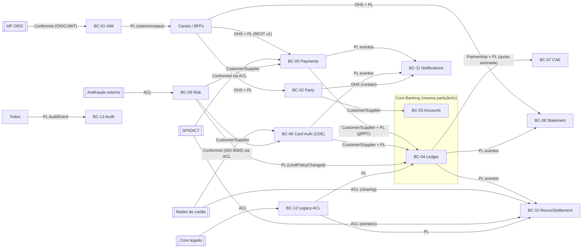

# Bounded Contexts e Fluxos Críticos — v0.1 (Proposta)

> Autor: `software-architect` (ETAPA1-C2-BC, delegação `3cc6f13b`); persistido pelo orquestrador em 2026-11-09. **Proposta, não aprovada.**
> Decisões relacionadas: ADR-0002, 0003, 0005, 0007, 0009, 0010.

## 1. Princípio de corte
Contextos cujas invariantes precisam valer **na mesma transação ACID** ficam juntos. Um contexto só se separa por um destes motivos:
- autoridade financeira diferente;
- escopo de conformidade (CDE, cofre de PII, auditoria);
- perfil de disponibilidade/escala;
- segmento de rede externo (RSFN, rede de cartão).

O que sobra é módulo de um monolito modular (ADR-0009).

| Decisão | Justificativa |
|---|---|
| **Fusão:** Accounts + Ledger + Posições + Holds + consumo de limite + Idempotência + Outbox = **Core Banking** | Débito checa bloqueio, disponível, holds, limite, idempotência, lançamento e outbox numa única transação. Separar exigiria 2PC ou abriria race conditions |
| Fusão: Reconciliation + Settlement | Mesmos dados e ciclo |
| Fusão lógica: Statement Query + Projector (2 deployments) | Escalam de formas diferentes |
| Separação: Card Authorization | Escopo PCI; latência da rede |
| Separação: Customer/Party | Cofre de PII; direitos do titular sem tocar o ledger |
| Separação: CAE | Autonomia regional quando o Core está indisponível |
| Separação: Audit | Segregação de funções; WORM |
| Separação: Payments | Workflows longos externos; não pode prender o writer |
| Separação: Risk | Escala, fornecedor, ciclo de regras |
| Separação: Legacy ACL | Isola o legado; descomissionável |

## 2. Catálogo
LGPD = dado pessoal; LGPD-S = possivelmente sensível (art. 5º II, a validar); PCI = ambiente de dados de cartão.

| BC | Responsabilidade | Agregados | Invariantes essenciais | Dados | Autoridade |
|---|---|---|---|---|---|
| **BC-01 Identity & Access** | Federação com IdP (nunca auth própria); subject → partyId; device binding; step-up; revogação | SubjectLink, DeviceBinding, ClientRegistration | 1 subject ativo → 1 party; dispositivo revogado não autentica; tokens de usuário/serviço/operador não intercambiáveis | IDs pseudônimos (LGPD) | IdP (credenciais); IAM (vínculos) |
| **BC-02 Customer/Party** | PF/PJ, KYC, contatos, representantes, consentimentos, pedidos do titular | Party, KycCase, ConsentRecord | Documento único (cifrado + hash chaveado); sem KYC não abre conta; consentimento versionado por finalidade | PII (LGPD; biometria LGPD-S) | Party |
| **BC-03 Accounts** (Core) | Ciclo de vida, titularidade, mandatos, produto | Account, AccountBlock | Bloqueada/encerrada não debita (exceções judiciais a validar); encerramento exige saldo zero, sem holds | accountId/partyIds | Writer da partição |
| **BC-04 Ledger** (Core, fonte oficial) | Diário de partidas dobradas; posições; holds; consumo de limite; idempotência; outbox; quotas CAE | AccountPosition, JournalEntry, Hold, IdempotencyRecord, OutboxMessage, PartitionControl | Σ D = Σ C por entry e moeda; append-only; `disponível = contábil − holds − bloqueado (+ limite)`; chave + hash → 1 resultado; epoch vigente em toda escrita; sequência monotônica; data contábil pelo calendário de negócio | Valores (fora do CDE; sem nome/CPF/PAN) | **Um writer por partição + fencing** |
| **BC-05 Payments/Transfers** | Ordens internas, Pix (envio, recebimento, DICT, devoluções), TED/boleto (a validar), agendamentos, saga | PaymentOrder, ScheduledPayment, ExternalInstruction | 1 ordem por chave; transições monotônicas; crédito externo só após liquidação confirmada; **UNKNOWN nunca re-debitado nem desviado ao CAE** | Beneficiário, chave Pix (LGPD) | Payments (ordem); Ledger (dinheiro) |
| **BC-06 Card Authorization** (CDE) | Emissor: ISO 8583, HSM, token → conta, hold, advices/STIP, reversão, captura, estorno, chargeback | CardAuthorization, Card | PAN não sai do CDE; chave de rede → 1 decisão; captura ≤ autorizado + tolerância; estorno pós-captura = novo lançamento | PCI + LGPD | Card (ciclo); Ledger (saldo) |
| **BC-07 CAE** | Aprovar só dentro de quota assinada; journal; replay | QuotaAllocation, ContingencyTransaction | Σ consumo ≤ quota; quota de 1 região/instância; expirada/assinatura inválida → DECLINED; sem quota → DECLINED/UNAVAILABLE; replay idempotente; **requisições já despachadas ao Core inelegíveis** | accountId, valor (PCI se tocar cartão) | Só consumo da própria quota |
| **BC-08 Statement/Read Models** | Extrato, histórico, saldo informativo | StatementLine, BalanceSnapshot, ProjectionCheckpoint | Projeção idempotente por entryId; ordem por sequência; watermark; **nunca autoriza** | LGPD | Nenhuma financeira |
| **BC-09 Limits & Risk** | Políticas de limite, scoring, regras, step-up, política offline | LimitPolicy, RiskRule, RiskDecision | Decisão registra versão da política; indisponível → comportamento da política (fail-closed em alto risco); **contador de consumo fica no Ledger** | Perfil comportamental (LGPD; art. 20 a validar) | Política/decisão |
| **BC-10 Reconciliation & Settlement** | Conciliar ledger × redes × SPI × legado × clearing; exceções | ReconciliationRun, MatchRecord, Break, SettlementBatch | Reprocessamento idempotente; toda divergência vira exceção; **ajustes só por reversão/compensação com dupla custódia**; clearing entre partições fecha em zero | Arquivos podem ter PAN → CDE ou tokenizados | Estado da conciliação |
| **BC-11 Notifications** | Push/SMS/e-mail | — | Dedupe (eventId, canal); conteúdo mínimo; contato consultado no Party | Mínimo | — |
| **BC-12 Core Legacy ACL** | Tradução; roteamento por SoR; sincronização da migração | — | **Cada conta tem exatamente um SoR (`LEGACY`/`NEW`)**; sem dual-write; IDs estáveis | LGPD | Legado para `LEGACY` |
| **BC-13 Audit** | Trilha imutável de ações, decisões, políticas, acessos a PII | AuditRecord (hash), AuditSeal | Append-only; tamper-evident; acesso segregado | LGPD (sem tokens/PAN/CPF completo) | Audit |

### Comandos e eventos principais
- **Ledger (gRPC interno):** PostEntry, DebitLeg, CreditLeg, PlaceHold, CaptureHold, ReleaseHold, Reverse, AllocateContingencyQuota, SettleContingency, GetCommandResult(key).
- **Eventos do Ledger (outbox):** JournalEntryPosted, HoldPlaced/Captured/Released/Expired, BalanceChanged, QuotaAllocated/Released.
- **Payments:** PaymentInitiated/Completed/Failed/Returned. **Card:** CardAuthorized/Declined/Reversed/Captured/Refunded, StandInAdviceReceived.
- **Party:** PartyRegistered, KycApproved, PartyBlocked, ConsentChanged (payload só com partyId). **Risk:** RiskDecisionMade, LimitPolicyChanged, FraudAlertRaised.

## 3. Context map



OHS = Open Host Service; PL = Published Language; ACL = Anti-Corruption Layer. A relação Partnership entre Ledger e CAE indica que o protocolo de quota é versionado em conjunto.

## 4. Fluxos críticos

### 4.1 Transferência com idempotency key

```mermaid
sequenceDiagram
  autonumber
  participant C as Canal
  participant G as Gateway
  participant P as Payments
  participant R as Risk
  participant L1 as Core P_origem (epoch e1)
  participant L2 as Core P_destino (epoch e2)
  C->>G: POST /v1/transfers Bearer, Idempotency-Key K
  G->>P: JWT pré-validado + correlation-id
  P->>P: revalida JWT, autoriza titular x conta; TX: ordem (scope+K, hash) PENDING
  P->>R: EvaluateRisk (deadline)
  R-->>P: ALLOW
  P->>P: DISPATCHED (inelegível para CAE)
  P->>L1: DebitLeg(key=transferId:1, e1)
  Note over L1: TX: epoch, idempotência, status, disponível, limite, JournalEntry (D cliente / C clearing), outbox
  L1-->>P: COMMITTED
  P->>L2: CreditLeg(key=transferId:2)
  Note over L2: TX: D clearing / C beneficiário, outbox
  L2-->>P: COMMITTED
  P->>P: COMPLETED + resposta persistida sob K
  P-->>C: 201 (ou 202 PENDING se a perna 2 estiver em andamento)
```

Na mesma partição, as duas pernas ocorrem numa única transação. Se a perna 2 falhar por regra de negócio, compensa com `Reverse(perna 1)`, nunca por edição.

### 4.2 Cartão: reserva → captura → estorno

```mermaid
sequenceDiagram
  autonumber
  participant N as Rede
  participant A as Card Auth (CDE)
  participant H as HSM/Vault
  participant L as Core
  N->>A: 0100 (chave de rede)
  A->>H: criptograma/PIN; token -> conta
  A->>L: PlaceHold(key=chave de rede, valor, validade)
  L-->>A: HOLD_PLACED (disponível reduzido; sem lançamento)
  A-->>N: 0110 aprovado
  alt Reversão antes da captura
    N->>A: 0400
    A->>L: ReleaseHold(key) idempotente
  else Captura
    N->>A: presentment
    A->>L: CaptureHold(key, valor final)
    Note over L: JournalEntry D cliente / C liquidação; libera residual
  end
  opt Estorno após captura
    N->>A: refund
    A->>L: PostEntry(key=refundId) compensatório
  end
  Note over A,L: Timeout no Core dentro do prazo da rede: resposta externa de recusa; estado interno UNKNOWN; ReleaseHold compensatório idempotente; GetCommandResult (ver CF-07)
```

### 4.3 Timeout após commit
1. Commit realizado e resposta gravada sob K; a resposta se perde.
2. Reenvio com a mesma K e o mesmo payload: devolve **o mesmo status e corpo**, com `Idempotent-Replayed: true`, sem reexecutar.
3. Mesma K com payload diferente: `422` Problem Details `idempotency-key-reused` (CF-10).
4. Mesma K ainda em andamento: `409` com `Retry-After`.
5. Timeout interno entre Payments e Core: ordem em **UNKNOWN**, depois `GetCommandResult(key)` ou repetição com a **mesma** chave. Nunca chave nova, nunca FAILED sem confirmação, nunca CAE.

### 4.4 Contingência

```mermaid
sequenceDiagram
  autonumber
  participant L as Core (antes da falha)
  participant E as CAE região R
  participant CP as Control plane
  participant P as Payments/Card
  L->>L: AllocateContingencyQuota (hold de quota na conta A)
  L->>E: QuotaAllocation assinada (KMS), epoch, expiry
  CP->>P: partição Px em CONTINGENCY (declarado pelo control plane, não por timeout)
  P->>P: requisição K nunca despachada ao Core?
  alt elegível
    P->>E: AuthorizeInContingency(K, A, valor)
    E->>E: assinatura, validade, regras offline, teto, saldo da quota
    E->>E: TX journal (consumo + contingencyTxnId)
    E-->>P: APPROVED_CONTINGENCY ou DECLINED/UNAVAILABLE
  else já despachada / UNKNOWN
    P-->>P: UNKNOWN (consultar depois); não vai ao CAE
  end
  Note over E,L: Core volta: SettleContingency(key=contingencyTxnId) idempotente contra o hold de quota
```
