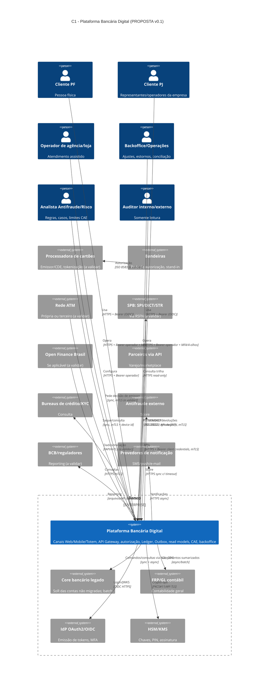
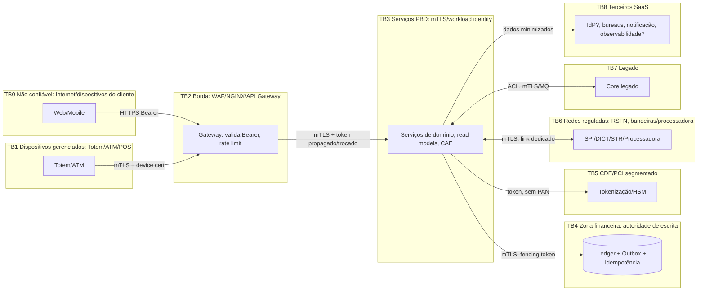

# C1 — Contexto do Sistema

- Versão: 0.1 (**PROPOSTA — não aprovada**)
- Data: 2026-11-09
- Autor: `solution-architect` (ETAPA1-C1-NFR, delegação `d541b605`); persistido pelo orquestrador
- Revisores pendentes: software-architect, security-privacy, devops-platform, performance-analyst, Compliance/Jurídico
- ADRs relacionadas: ADR-0002..0014 (todas Proposed). Conflitos: `docs/architecture/etapa1-consolidacao.md`

## 1. Escopo
**Plataforma Bancária Digital (PBD):**
- canais próprios (Web, Mobile, Totem);
- borda de APIs (NGINX/Gateway), autorização por recurso e integração com o IdP OIDC;
- autorização financeira (débito, Pix, autorização de cartão como emissor, a validar);
- Ledger de partidas dobradas, autoridade das partições migradas;
- Outbox, broker (não é ledger), read models, CAE;
- ACL do core legado, backoffice, auditoria e observabilidade.

Fora deste nível: detalhamento interno (C2/C3), operação interna da processadora, infraestrutura RSFN/SPB, ERP/GL corporativo e internals do IdP.

## 2. Premissas (todas A VALIDAR)

| ID | Premissa | Validar com |
|---|---|---|
| P-01 | Banco é **emissor** de cartões; autorização via bandeira/processadora; **não** é adquirente | Negócio |
| P-02 | Existe core legado, SoR atual de contas/saldos/lançamentos, com janelas batch | Negócio/TI legado |
| P-03 | Participação no Pix/SPI (direta, indireta ou PSTI) indefinida | Negócio/Compliance |
| P-04 | Participação no Open Finance (obrigatória/fase/voluntária) indefinida | Compliance |
| P-05 | Rede ATM própria ou compartilhada | Negócio |
| P-06 | Totem é dispositivo gerenciado em loja com identidade de dispositivo | Negócio/Segurança |
| P-07 | ≥ 2 sites de falha independentes no Brasil; localização sujeita a normativos BCB/CMN | DevOps/Compliance |
| P-08 | IdP OIDC de mercado; nenhuma autenticação própria de tokens | Segurança |
| P-09 | PAN/CDE na processadora/vault; a PBD trabalha com tokens | Compliance/QSA |
| P-10 | Sem dados reais de TPS; dimensionamento paramétrico | Performance/Negócio |

## 3. Core híbrido (proposta — ADR-0007)
Cada conta/partição tem **exatamente uma autoridade de escrita** em qualquer instante, registrada num *Authority Registry* versionado (conta → {autoridade, epoch/fencing}). **Sem dual-write.** Cache e read models nunca autorizam débito.

| Domínio | Fase 0 (convivência) | Fase 1 (strangler por coorte) | Alvo |
|---|---|---|---|
| Saldo/lançamentos de contas existentes | Legado | Legado (não migradas) / Ledger (migradas) | Ledger |
| Contas de produtos novos | Ledger | Ledger | Ledger |
| Decisão de débito/Pix | PBD consulta a autoridade via ACL | PBD roteia pelo Registry | PBD + Ledger |
| Autorização de cartão (emissor) | Processadora/legado (a validar) | PBD decide; processadora encaminha | ADR-0012 |
| Limite de crédito/fatura | Processadora/legado (a validar) | Sem mudança | A decidir |
| Contabilidade geral | Legado/ERP | Recebe lançamentos sumarizados (async, reconciliados) | ERP |
| Cadastro/KYC master | Legado/MDM | Party service + sincronização via ACL | A decidir |
| Chaves Pix | DICT é o SoR | Idem | Idem |
| Extrato | Read model (CDC do legado + eventos do Ledger) | Idem | Read model |

**Strangler:**
1. Leitura primeiro (CDC → read models).
2. Produtos novos nascem no Ledger.
3. Migração por coorte: congelar (epoch++ e fencing no legado), drenar reservas, carga final, reconciliar saldos contábil/disponível/bloqueado/reservado e holds, trocar a autoridade no Registry, descongelar.
4. Rollback: antes do primeiro lançamento novo, reverter o Registry; depois, migração compensatória.
5. Janela batch do legado: só quotas do CAE; fora delas UNAVAILABLE. **Nunca** saldo-sombra em cache.

## 4. Diagrama de contexto

## 5. Limites de confiança

> Nota de consolidação: a numeração TB deste C1 (TB0–TB8) difere da do threat model (TB0–TB10) e das zonas do C2 (Z0–Z7). Unificar na v0.2 (CF-09).

## 6. Elementos

| ID | Elemento | Tipo | Observação | Status |
|---|---|---|---|---|
| E-P1 | Cliente PF | Pessoa | Titular (LGPD) | Confirmado |
| E-P2 | Cliente PJ | Pessoa | Múltiplos usuários/poderes | A validar |
| E-P3 | Operador de agência/loja | Pessoa | Token de operador | A validar |
| E-P4 | Backoffice | Pessoa | Ajustes por compensação, 4-olhos | Proposto |
| E-P5 | Antifraude/Risco | Pessoa | Políticas, quotas CAE | Proposto |
| E-P6 | Auditor | Pessoa | Leitura da trilha WORM | Proposto |
| E-P7 | Encarregado (DPO) | Pessoa | Direitos do titular | A validar |
| E-C1..C7 | Web (BFF), Mobile, Totem, ATM, POS (via processadora), Parceiros, Open Finance | Canais | Ver premissas P-01, P-04..P-06 | Proposto/A validar |
| E-S1 | Core legado | Externo interno | Autoridade das contas não migradas | A validar |
| E-S2..S4 | Processadora, Bandeiras, Adquirentes (indireto) | Externos | CDE, stand-in | A validar |
| E-S5..S7 | SPI, DICT, STR | Externos regulados | Via RSFN | A validar |
| E-S8 | Bureaus | Externo | Crédito/KYC | A validar |
| E-S9 | IdP OIDC | Plataforma | Cliente, operador, serviço | Proposto (ADR-0006) |
| E-S10 | HSM/KMS | Plataforma | PIN, chaves, assinatura de quotas | Proposto |
| E-S11 | Antifraude externo | Externo | Score com timeout | A validar |
| E-S12 | BCB/reguladores | Externo | Reporting | A validar |
| E-S13 | Notificações | SaaS | Conteúdo minimizado | Proposto |
| E-S14 | ERP/GL | Externo interno | Contabilidade | A validar |
| E-S15 | Observabilidade SaaS | Externo | Risco de transferência internacional | A validar |

## 7. Relações

| ID | Origem → Destino | Protocolo | Modo | Dados | Fronteira |
|---|---|---|---|---|---|
| R-01 | Cliente → PBD | HTTPS TLS 1.2+/1.3, Bearer | Sync | C2/C3 | TB0→TB2 |
| R-02 | Totem/ATM → PBD | mTLS + certificado de dispositivo | Sync | C3 (+C4 via HSM) | TB1→TB2 |
| R-03 | Bandeira → Processadora → PBD | ISO 8583/API, mTLS (a validar) | Sync, timeout rígido | Token, valor, MCC | TB6→TB3 |
| R-04/05 | PBD ↔ SPI | ISO 20022 via RSFN | Sync/async | C3 | TB4↔TB6 |
| R-06 | PBD ↔ DICT | API via RSFN, mTLS | Sync | C2/C3 | TB3↔TB6 |
| R-07 | PBD ↔ STR | Mensageria SPB | Async | C3 | TB4↔TB6 |
| R-08 | PBD ↔ Legado | MQ/API/arquivo + CDC | Sync + async | C2/C3 | TB3↔TB7 |
| R-09 | PBD → ERP | Arquivo/evento | Async | Agregado | TB3→TB7 |
| R-10 | PBD ↔ IdP | OIDC | Sync (JWKS em cache) | Credenciais | TB2↔TB8 |
| R-11 | PBD → HSM/KMS | PKCS#11/API TLS | Sync | Segredos | →TB5 |
| R-12/13 | PBD → Bureaus / Antifraude | HTTPS mTLS | Sync com timeout | C2/C3 minimizado | TB3→TB8 |
| R-14 | PBD → BCB | Arquivos/API | Batch | C3 | TB3→TB6 |
| R-15 | PBD → Notificações | HTTPS via Outbox | Async | C2 mínimo | TB3→TB8 |
| R-16 | Parceiro → PBD | HTTPS, client credentials, mTLS | Sync | C2/C3 | TB0→TB2 |
| R-17 | Open Finance ↔ PBD | FAPI/mTLS (a validar) | Sync | C3 + consentimento | TB6↔TB2 |
| R-18 | Operadores → PBD | HTTPS, token de operador, MFA, JIT | Sync | C3 | →TB2 |

## 8. Classificação de dados (proposta — ADR-0011)

| Classe | Conteúdo | Regra ao cruzar fronteira |
|---|---|---|
| C0 Público | Tarifas, conteúdo público | Livre |
| C1 Interno | Métricas agregadas | TLS |
| C2 Pessoal | Nome, contato, IDs vinculáveis | TLS + minimização |
| C3 Pessoal financeiro | Saldos, transações, chaves Pix, CPF/CNPJ (pessoal, **não** automaticamente sensível) | mTLS, pseudonimização em eventos, mascaramento em logs |
| C3-S Sensível (art. 5º II) | Biometria e similares | Isolamento, cifra dedicada, RIPD |
| C4 PCI | PAN; SAD | Somente CDE/HSM; fora dele, token; SAD nunca armazenado |
| S Segredos | Chaves, tokens, credenciais | KMS/HSM/secret manager; nunca em logs |

## 9. Legenda
`Rel` sólido = síncrono, salvo indicação "async". TB = limite de confiança. "A validar" = premissa não confirmada. Broker não é ledger; cache não é fonte de saldo.

## 10. Riscos

| ID | Risco | Mitigação |
|---|---|---|
| RC-01 | Autoridade ambígua legado/Ledger → gasto duplo | Authority Registry + fencing; sem dual-write (ADR-0007) |
| RC-02 | Legado em batch afetando T0 | Quotas CAE; UNAVAILABLE explícito |
| RC-03 | Poucos sites no Brasil × residência | ADR-0008/0011 |
| RC-04 | Hot accounts no single-writer | Sub-contas + netting (ADR-0010) |
| RC-05 | Stand-in da bandeira fora da visão do emissor | Advices como lançamento forçado idempotente |
| RC-06 | IdP no caminho síncrono | Validação local com JWKS em cache |
| RC-07 | Telemetria/SaaS fora do país | ADR-0011; DLP |
| RC-08 | Premissas erradas invalidam o C1 | Validação com negócio antes do C2 final |
