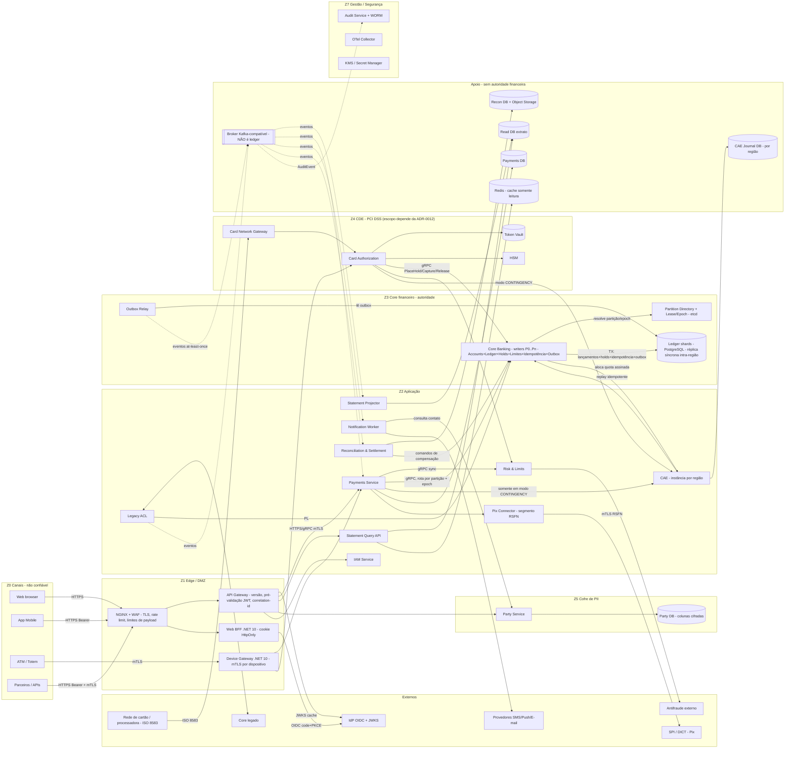

# C2 — Containers

> Status: **PROPOSTA v0.1 (2026-11-09)**. Autor: `software-architect` (ETAPA1-C2-BC, delegação `3cc6f13b`); persistido pelo orquestrador.
> Depende das ADR-0002..0014 (todas Proposed). **Não implementar antes de Accepted.**
> Container C4 = unidade executável ou de armazenamento, não container Docker. Bounded contexts e fluxos: `docs/architecture/bounded-contexts.md`.

## Escopo
Plataforma bancária com canais Web, Mobile, Totem, ATM, POS (via rede de cartão) e APIs de parceiros; core híbrido (novo + legado); ledger como fonte oficial; autorização de cartão; contingência.

## Premissas (validar)
- P1: .NET 10 (LTS) / C# 14; SDK 10.0.403 instalado (verificado pelo orquestrador) — ADR-0013.
- P2: plataforma active-active para leitura/canais; cada partição financeira tem **uma região home e um único writer**. Fase 1: todas as partições com home em R1 (ADR-0002). Sites efetivos e residência a validar.
- P3: autenticação delegada a IdP OIDC externo (ADR-0006).
- P4: banco atua como emissor de cartão. Se for também adquirente, revisar.
- P5: modelo de participação no Pix em aberto.
- P6: TPS, latência e RTO/RPO conforme `capacity-model.md`, `nfr.md` e consolidação.

## Diagrama

Legenda: seta cheia = síncrono (HTTPS/gRPC); tracejada = evento via broker; cilindro = store; Z0–Z7 = zonas de confiança. Entre zonas, sempre mTLS com workload identity.

## Containers

| # | Container | Responsabilidade | Tecnologia candidata | Dados | Escala | Autoridade de escrita |
|---|---|---|---|---|---|---|
| 1 | NGINX + WAF | TLS, rate limit, payload, L7 | NGINX (controlador: ADR pendente, CF-08) | Não loga Authorization | Horizontal | — |
| 2 | API Gateway | Roteamento /v1, pré-validação JWT, quotas, correlation-id | NGINX/gateway gerenciado | — | Horizontal | — |
| 3 | Web BFF | OIDC code+PKCE; tokens no servidor | ASP.NET Core 10 | Sessão (Redis cifrado) | Horizontal | — |
| 4 | Device Gateway | mTLS por dispositivo, tradução de protocolo | ASP.NET Core 10 | Registro de dispositivo | Horizontal | — |
| 5 | IAM Service | SubjectLink, DeviceBinding, step-up, revogação | ASP.NET Core 10 + PostgreSQL | IDs pseudônimos | Horizontal | IAM (vínculos); IdP (credenciais) |
| 6 | Party Service | Cadastro, KYC, consentimento, direitos do titular | ASP.NET Core 10 + PostgreSQL com cifra de coluna (KMS) | PII | Horizontal | Party |
| 7 | **Core Banking** | Accounts, Ledger, posições, holds, limite, idempotência, outbox, alocação de quota | ASP.NET Core 10 gRPC; monolito modular | Ledger (fora do CDE) | Por partição lógica; 1 writer ativo por partição | **Writer com epoch vigente** |
| 8 | Ledger shards | Armazenamento transacional | PostgreSQL, réplica síncrona intra-região | Idem | Shard por grupo de partições | Só writer com epoch válido |
| 9 | Partition Directory + Lease | accountId → partição → shard/home/SoR; leases e epochs | etcd + cache no cliente validado por epoch | Metadados | 3–5 nós | Control plane |
| 10 | Outbox Relay | Publica após commit | Worker .NET (polling) → CDC quando necessário | Eventos sem PII direta | 1 ativo por shard (lease) | — |
| 11 | Broker | At-least-once, chave = accountId | Kafka-compatível | **Não é ledger** | Partições | — |
| 12 | Payments Service | Ordens, saga entre partições, Pix/TED, agendamentos | ASP.NET Core 10 + PostgreSQL | Beneficiários mascarados | Horizontal | Estado da ordem |
| 13 | Pix Connector | Mensageria SPI/DICT, certificados | Worker .NET 10 + HSM/KMS | ISO 20022 | Ativo/ativo com dedupe | — |
| 14 | Card Authorization | Decisão de emissor, hold, reversão, clearing, estorno, STIP | .NET 10 (Native AOT a avaliar) | PCI | Co-localizado com a home | Ciclo da autorização |
| 15 | Card Network Gateway | Sessões ISO 8583 | .NET 10 / produto | PCI | Ativo/ativo | — |
| 16 | Token Vault + HSM | Tokenização, PIN, chaves | Produto certificado | PCI | Gerenciado | Vault |
| 17 | Risk & Limits | Scoring, regras, políticas, política offline | ASP.NET Core 10 + Redis + PostgreSQL | Perfil comportamental | Horizontal | Política/decisão (**não** o contador de consumo) |
| 18 | CAE (por região) | Aprovação dentro de quota; journal; replay | .NET 10 + PostgreSQL local | accountId, valores | 1 por região/canal | Consumo da própria quota |
| 19 | Statement Query + Projector | Extrato e saldo informativo com watermark | .NET 10 + PostgreSQL particionado + Redis | LGPD | Réplicas de leitura | Nenhuma financeira |
| 20 | Reconciliation & Settlement | Matching, exceções, liquidação | .NET 10 + PostgreSQL + Object Storage | PCI se receber PAN | Batch/stream | Ajustes só por comando ao Core |
| 21 | Notification Worker | Envio com dedupe | .NET 10 | Conteúdo mínimo | Horizontal | — |
| 22 | Legacy ACL | Tradução e roteamento por SoR | .NET 10 | LGPD | Conforme legado | Legado para contas `LEGACY` |
| 23 | Audit Service | Trilha encadeada, WORM | .NET 10 + Object Storage (object lock) | LGPD | Append-only | Audit |
| 24 | Observabilidade | OTel, métricas, logs, traces, SIEM | OpenTelemetry | Sem PII/segredos | — | — |
| 25 | KMS/Secret Manager | Chaves, segredos, assinatura de quotas | Gerenciado/HSM | — | — | — |

## Autoridade única, particionamento e fencing (ADR-0002)
1. **Particionamento:** espaço fixo de partições lógicas (proposta: 4096, CF-05). Conta atribuída na abertura e gravada no Directory (sem re-hash), o que permite migrar partições. Cada partição registra shard, home, SoR e epoch.
2. **Roteamento:** biblioteca cliente partition-aware (NuGet interno), usada por Payments, Card, Recon, ACL e CAE. Writer errado responde `WRONG_PARTITION_OWNER`.
3. **Fencing:** lease no Directory → `epoch` monotônico. Ao assumir: `UPDATE partition_control SET epoch=:e WHERE partition_id=:p AND epoch < :e`. **Toda transação de escrita valida `epoch = :e` dentro da própria transação.** Lease sozinho não basta.
4. **Fencing do banco:** promoção do primário do shard isola o primário antigo.
5. **Failover inter-região:** só após isolar writer e primário antigos; com replicação assíncrona, **RPO > 0**. A partição entra em `RECOVERY` (só leitura + CAE) até reconciliar.
6. **Entre partições:** saga orquestrada por Payments, com contas de clearing por partição; cada perna balanceada; **2PC rejeitado** (ADR-0010).

## Regras de dados
Ledger = fonte oficial. Broker = transporte. Redis e read DB **nunca** autorizam débito. Saldo autoritativo lido no Core; extrato vem do read model com watermark. Eventos com IDs pseudônimos, sem CPF, nome, PAN ou token.

## Limites de confiança
Z0→Z1: TLS + Bearer ou mTLS. Z1→Z2..Z5: mTLS + workload identity; token propagado ou trocado; **cada serviço revalida o JWT e autoriza por recurso**. Z4 e Z5 com rede, contas e chaves segregadas. Z3 só aceita gRPC de serviços internos autorizados.

## Riscos
Hot accounts internas (ADR-0010); RPO inter-região (ADR-0008); autoridade do core híbrido (ADR-0007); STIP da bandeira; custo operacional de ~13 deployables e muitos shards (revisar com DevOps).
