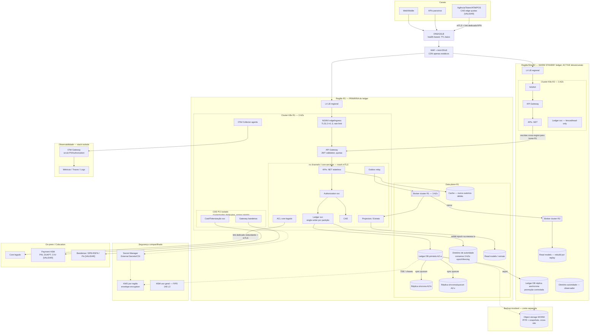

# Topologia de Infraestrutura — v0.1 (Proposta)

> Status: **Proposta — não aprovada.** Autor: `devops-platform` (ETAPA1-INFRA-TOPOLOGY, resp. à delegação `8ec112f9`). Persistido pelo orquestrador em 2026-11-09.
> Legenda: **[FATO]** verificável · **[REC]** recomendação · **[VALIDAR]** depende de Negócio/Compliance/Jurídico/medição.
> Decisões relacionadas: ADR-0002, ADR-0007, ADR-0010 (ver `docs/governance/DECISIONS.md`).

## 0. Premissas
- Serviços .NET 10 stateless em Kubernetes. **Kubernetes não resolve HA do banco**; o data plane com estado tem desenho próprio.
- Ledger relacional; single-writer por partição de conta com fencing token monotônico.
- Outbox → broker. Broker não é ledger; cache/read model nunca autoriza débito.
- CAE com quotas pré-alocadas; quotas na borda (agência/totem/ATM) [VALIDAR].
- ACL para core legado (provavelmente on-prem). Integrações: bandeiras, Pix/SPB [VALIDAR], antifraude, HSM.
- RPO/RTO/SLO **não aprovados** (PROJECT-STATUS). Números abaixo são metas propostas [VALIDAR].

## 1. Topologia

### 1.1 Restrição geográfica
- [VALIDAR Compliance/Jurídico] Residência de dados no Brasil para ledger, PII, logs e backups.
- [VALIDAR oferta atual] Vários hyperscalers têm uma única região no Brasil. Com residência obrigatória, a segunda "região" pode precisar ser site híbrido (DC próprio/colocation), multi-cloud ou provedor com 2 regiões no país. **Essa restrição domina a escolha A vs B.**
- Latências estimadas [VALIDAR por medição]: inter-AZ < 2 ms RTT; SP↔Campinas ~1–3 ms; SP↔Rio ~5–10 ms. Commit síncrono inter-região soma ≥ 1 RTT + fsync remoto.

### 1.2 Opções

| Critério | (A) Active-active multi-região, single-writer por partição | (B) Ledger active-passive (warm standby); canais/leitura active-active |
|---|---|---|
| Escrita | Cada partição tem região *home*; ambas as regiões escrevem | Todas as partições com home em R1 |
| RPO perda de AZ | 0 (quorum síncrono 3 AZs) | 0 |
| RPO perda de região | 0 só com consenso em 3 sites; assíncrono = segundos | Segundos (assíncrono); 0 só com 3º site síncrono |
| RTO perda de região | Minutos, só partições afetadas (rehome) | 15–60 min (promoção controlada) [VALIDAR] |
| Latência de escrita | Local à home; exige roteamento por partição (GSLB não basta) | Canais em R2 escrevem cross-region (+RTT) |
| Complexidade | Alta (diretório de partições, rehome, CAE por região sem duplicar quota) | Média (um ponto de promoção) |
| Custo | Maior | Menor (R2 escala no failover) |
| Split-brain | Por partição; fencing maduro desde o dia 1 | Concentrado num ponto, mais auditável |

### 1.3 Recomendação [REC]
**Fase 1 = opção B implementada como caso degenerado de A** (todas as partições com home em R1). Desde o dia 1 o modelo carrega `partition_id`, `home_region`, `epoch` e diretório de autoridade, para que migrar para A seja rehome gradual, não reescrita.
- Justificativa: RPO=0 contra falha de AZ (a mais frequente) sem latência inter-região; maturidade de fencing/reconciliação antes de multiplicar pontos de promoção; custo; possível inviabilidade de A sem site híbrido.
- Critérios para evoluir para A: RPO/RTO/TPS aprovados; game days de failover regional com RPO/RTO medidos; reconciliação automatizada com divergência zero em N execuções; 3º site se RPO=0 inter-região for exigido.
- Se o Negócio exigir **RPO=0 com perda de região**: 3 sites (2 regiões + witness, síncrono em ≥ 2) ou SQL distribuído com consenso — ADR própria.

### 1.4 Nuvem / on-prem / híbrido [REC, VALIDAR]
- **Nuvem (2 locais):** canais, APIs, ledger, broker, read models, observabilidade.
- **On-prem/colocation:** core legado (via ACL); Payment HSM (se não houver gerenciado aceito por PCI); conectividade com redes de pagamento e SPB/RSFN [VALIDAR]; possível 2º site de DR in-country.
- **Conectividade:** links dedicados redundantes (2 provedores, 2 POPs), BGP, IPsec/MACsec, sem internet pública. O core legado é SPOF: ACL com circuit breaker e semântica UNKNOWN.

## 2. Diagrama de implantação

**Segmentação [REC]:** namespaces `edge`, `channels`, `core-services` (ledger, autorização, CAE), `integration` (ACL, antifraude), `cde`, `platform`, `observability`. CDE preferencialmente em **cluster dedicado** (reduz escopo PCI) [VALIDAR com QSA]. Ledger DB fora do Kubernetes (gerenciado/VMs dedicadas) ou operator maduro com HA própria — nunca StatefulSet sem desenho de HA.

## 3. Failover da escrita financeira

### 3.1 Princípios
1. Single-writer por partição registrado em diretório de autoridade com consenso (quorum ímpar, 3 AZs) e `epoch` monotônico.
2. **Fencing no armazenamento**: toda transação de escrita valida `partition.epoch = :token` **na mesma transação**. Escritor com epoch defasado falha. Lease sem fencing não basta.
3. Intra-região: failover automático com quorum; epoch incrementado antes de aceitar escrita.
4. Inter-região: **promoção manual com dois aprovadores** (semiautomática permitida). Com replicação assíncrona, nunca promover como se RPO=0: registrar LSN de corte.
5. Isolamento antes da promoção (STONITH lógico): revogar credenciais de escrita da região antiga, read-only no primário antigo, bloquear ingress de escrita, epoch++, só então promover.
6. Gatilhos [VALIDAR limiares]: perda de quorum DB/diretório; indisponibilidade confirmada por ≥ 2 sinais independentes; erro de commit > X% por Y min. **Nunca** um único health check.

### 3.2 Transações in-flight
- Sem confirmação de commit durável → **UNKNOWN** (nunca DECLINED/APPROVED). Canal consulta status ou repete com a mesma idempotency key.
- Tabela de idempotência no mesmo banco e transação que lançamentos e outbox.
- Risco da replicação assíncrona: commits perdidos no RPO podem ter gerado eventos publicados ou efeitos externos. Mitigações: **outbox relay publica só até o LSN já replicado ao DR** (watermark); reconciliação obrigatória pós-failover com compensação (nunca edição); partições afetadas em "reconciliação pendente" (débitos bloqueados ou em CAE).
- CAE aprova apenas dentro de quotas pré-alocadas, não duplicadas entre regiões, com journal durável reconciliado.

### 3.3 Runbook (falha de região)
1. Detectar e declarar incidente. 2. Congelar rehome/deploys; escritas da região afetada → CAE ou UNAVAILABLE. 3. Isolar (credenciais, fencing, bloqueio na borda) e confirmar. 4. Avaliar último LSN replicado/RPO efetivo. 5. Decidir com 2 aprovadores e registrar LSN de corte. 6. Promover: epoch++, réplica promovida, abertura gradual (canário de partições). 7. Redirecionar GSLB, diretório de partições, invalidar caches. 8. Reconciliar outbox, broker, read models, journals CAE, contrapartes; resolver UNKNOWN. 9. Medir RPO/RTO, postmortem. 10. Failback planejado, nunca automático, mesmo protocolo de fencing.

## 4. Padrões Kubernetes e NGINX

### 4.1 Kubernetes [REC]
- **Disponibilidade:** ≥ 3 réplicas; `topologySpreadConstraints` por zona (maxSkew 1, `DoNotSchedule` em críticos) e hostname; PDB; `priorityClass` para ledger/autorização/CAE.
- **Escala:** HPA (CPU + RED); KEDA para consumers (lag do broker) e outbox relay; `maxReplicas` limitado pela capacidade de conexões do DB.
- **Recursos:** requests = limits de memória; limite de CPU opcional [medir throttling p99]; `DOTNET_GCHeapHardLimit`/percentual.
- **Probes:** `startupProbe`; liveness sem dependências; readiness reflete capacidade real; `preStop` + grace period > maior timeout + drain.
- **Rede:** NetworkPolicy default-deny ingress/egress com allow explícito (inclusive DNS); egress via proxy com allowlist.
- **Pod security:** PSA `restricted` (enforce); `runAsNonRoot`, `readOnlyRootFilesystem`, `allowPrivilegeEscalation: false`, `drop: [ALL]`, `seccompProfile: RuntimeDefault`, `automountServiceAccountToken: false`.
- **Identidade:** SA por workload, workload identity, RBAC mínimo, pipeline sem `cluster-admin`.
- **Imagens:** `mcr.microsoft.com/dotnet/aspnet:10.0-*-chiseled` (não-root), multi-stage, pin por digest, sem segredos em ARG/ENV/layers.
- **Admission:** só imagens assinadas, registries permitidos, por digest, com probes/limits/securityContext.

### 4.2 NGINX [REC]
- [VALIDAR] O projeto comunitário `kubernetes/ingress-nginx` anunciou retirada; avaliar NGINX Ingress Controller (F5) ou Gateway API (ex.: NGINX Gateway Fabric) — ADR.
- **TLS:** TLSv1.2/1.3, ECDHE+AEAD, HSTS ≥ 1 ano, OCSP stapling, session tickets off ou rotacionados, mTLS com terminais e parceiros.
- **Limites:** `client_max_body_size` por rota (64–256 KB em APIs financeiras [medir]); `limit_req` por chave opaca (client_id/hash do sub + IP); `limit_conn`.
- **Timeouts:** connect 1–2 s; read alinhado ao orçamento da API; header/body ~10 s; keepalive upstream.
- **Retries:** `proxy_next_upstream error timeout` apenas para métodos idempotentes; **nunca** `non_idempotent`. POST financeiro só é repetido pelo cliente com idempotency key.
- **Headers:** `nosniff`, CSP (frontends), `Referrer-Policy no-referrer`, `Cache-Control: no-store` em respostas financeiras, `server_tokens off`; propagar `traceparent`/`X-Correlation-Id`. JWT validado no gateway **e** nos serviços, não só no NGINX.
- **Logs:** JSON sem `$http_authorization`/`$http_cookie`; `$uri` em vez de `$request_uri`; rejeitar `access_token` em query (400); proibido `error_log debug` em produção.

## 5. Segredos e chaves [REC]
- External Secrets Operator ou Secrets Store CSI com workload identity; montagem em arquivo; etcd criptografado com KMS provider; nenhum Secret em Git.
- KMS: envelope encryption por região e classe (ledger, PII, logs, backups); chaves por ambiente; segregação (quem administra chave não administra dado).
- Payment HSM (PCI PTS HSM) para PIN, DUKPT, CVV/CVC, chaves de bandeira [VALIDAR provedor/on-prem com QSA]. HSM geral (FIPS 140-2/3 L3) para CA interna, assinatura de imagens (se não keyless) e assinatura de quotas do CAE.
- Rotação: credenciais de DB dinâmicas; certificados de mesh com validade de horas; certificados de borda automáticos com alerta a 30 dias; JWKS com sobreposição (ADR-0006); KMS anual ou conforme política [VALIDAR]; rotação testada em game day.

## 6. CI/CD, supply chain e ambientes [REC]
- **Pipeline:** runners efêmeros; SAST, SCA, secret scanning, IaC scanning, scan de imagem com gate; xUnit + Playwright; k6 em hml.
- **Supply chain:** SBOM (CycloneDX/SPDX), provenance SLSA (alvo L3), cosign (keyless OIDC ou KMS/HSM), attestations.
- **Admission:** Kyverno/Gatekeeper em `Enforce` em prod.
- **GitOps:** Argo CD/Flux; prod sem `kubectl` humano; promoção apenas troca digest (mesmo digest dev→hml→prod→DR); drift detection; break-glass auditado.
- **Ambientes:** dev e hml com dados sintéticos (hml com paridade 3 AZs); prod; DR quente com capacidade mínima. Contas/redes separadas.
- **Governança no servidor (complementa ADR-0001):** CODEOWNERS por caminho; PR com aprovação humana (2 para `infra/` e ledger); status checks; commits assinados; sem push direto/force-push; check de CI "path-segregation"; finding ID no PR cruzado com o JSONL; unificar `master`/`main`.

## 7. DR por classe

| Classe | Fonte de verdade | Estratégia | RPO / RTO propostos [VALIDAR] |
|---|---|---|---|
| Ledger, idempotência, outbox | Ledger DB | Quorum síncrono 3 AZs; assíncrono para R2; PITR; backup imutável fora do site | AZ: 0 / < 5 min · Região: segundos / 15–60 min |
| Diretório de autoridade | Consenso | 3 AZs; snapshot; epoch nunca regride (restore = epoch + margem) | 0 / minutos |
| Eventos (broker) | Derivado do outbox | Cluster por região + mirror; retenção > janela de replay | Reconstruível |
| Read models / extrato | Derivado | Rebuild por replay + snapshots; exibir frescor | Reconstruível; SLO de frescor |
| Cache | Descartável | Sem backup | n/a |
| Journals CAE | Durável local | Replicação e envio assinado; reconciliação obrigatória | 0 para o aprovado |
| Config/IaC | Git | GitOps; Git espelhado | Minutos |
| Chaves | KMS/HSM | Backup conforme provedor; cerimônia documentada | [VALIDAR] |

- Backups WORM em conta separada (break-glass), cópia em 2º site, chave distinta, retenção [VALIDAR Jurídico]. Restore mensal automatizado com verificação de partidas dobradas (soma zero), cadeia de hash e contagens.
- **Game days** (hml primeiro; prod só com aprovação formal): perda de pod/nó/AZ; perda de primário e quorum; partição de rede inter-AZ e inter-região (escritor antigo **deve** falhar no fencing); lag/perda do broker; falha/latência do core legado; DNS/GSLB; rotação de JWKS e certificados; indisponibilidade de HSM; timeout após commit; failover regional completo com RPO/RTO medidos.

## 8. Findings
Registrados em `docs/governance/agent-communications.jsonl` (OPS-001..OPS-012) e consolidados em `docs/architecture/etapa1-consolidacao.md`.

## 9. Decisões candidatas
Consolidadas nas ADRs 0002, 0007 e 0010 e na lista de decisões pendentes em `docs/architecture/etapa1-consolidacao.md`.
