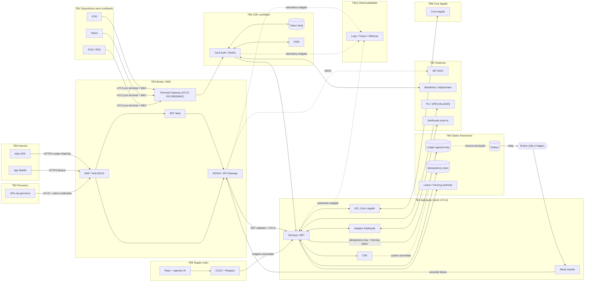

# Threat Model — v0.1 (Draft)

> Status: **Draft / Proposed.** Autor: `security-privacy` (ETAPA1-THREAT-MODEL, resp. à delegação `dcb49de8`). Persistido pelo orquestrador em 2026-11-09.
> Baseado na arquitetura-alvo do CLAUDE.md, porque C1/C2 foram produzidos em paralelo. **Revisar contra o C2 (v0.2).** Referências regulatórias marcadas **[VALIDAR Jurídico/Compliance/QSA]**.
> Decisões relacionadas: ADR-0002, 0003, 0005, 0006, 0011, 0012, 0014.

## 1. Escopo, premissas e método
**Escopo:** canais Web, Mobile, Totem, ATM, POS e parceiros; borda (WAF, NGINX, Gateway); serviços .NET 10; IdP OIDC externo; Ledger e Outbox; broker; read models; CAE; ACL do legado; bandeiras/adquirentes, Pix/SPB [VALIDAR], antifraude, HSM/KMS; Kubernetes multi-AZ/região; CI/CD; repositório com agentes de IA.

**Premissas:**
- P1: IdP externo OIDC; nenhum serviço emite token.
- P2: Ledger é a única autoridade financeira.
- P3: single-writer com fencing por partição.
- P4: CAE só aprova dentro de quotas assinadas.
- P5: papel de emissor/adquirente e participação no Pix indefinidos [VALIDAR].
- P6: região de nuvem indefinida, possível transferência internacional [VALIDAR].

**Método:** STRIDE por limite de confiança; Severidade = Impacto × Probabilidade; LINDDUN resumido. Referências: OWASP ASVS, OWASP API Top 10 (2023), RFC 8725, RFC 9700.

## 2. Ativos e classificação

| Ativo | Classe | Regras |
|---|---|---|
| PAN | PCI + pessoal | Tokenizar na entrada do CDE; fora dele, token ou PAN truncado |
| CVV/CVC2 | SAD | Não armazenar após autorização (não usar exceção de emissor) [VALIDAR QSA] |
| PIN / PIN block | SAD | Apenas HSM/PED |
| Credenciais (senha, OTP, seeds) | Autenticação | Somente no IdP |
| Access/refresh/ID tokens | Segredo de sessão | Vida curta; proibidos em logs, URLs e eventos |
| Chaves (JWKS, TLS/mTLS, TMK/TPK/BDK, DEK/KEK, assinatura de quotas/eventos) | Segredo crítico | HSM/KMS, separação por finalidade, rotação |
| CPF, nome, contato | Pessoal (art. 5º I) | Mascarar, minimizar, cifrar |
| Biometria (se houver) | **Sensível** (art. 5º II) | Art. 11 [VALIDAR] |
| Saldo, lançamentos, extrato | Financeiro identificável = pessoal; sigilo bancário (LC 105/2001) [VALIDAR] | Integridade máxima; não é automaticamente sensível no sentido do art. 5º II |
| Idempotency store, fencing tokens, leases | Integridade operacional | Alteração permite gasto duplo |
| Quotas e journal do CAE | Integridade financeira | Assinados e auditáveis |
| Eventos | Integridade + pessoal | Payload mínimo, assinatura/hash |
| Logs, traces, métricas | PII por vazamento | Redação na origem, RBAC |
| Dados de dispositivos | Integridade (+ possível pessoal) | Inventário, attestation |
| Repo, pipeline, imagens, `.claude/`, JSONL | Supply chain e governança | Integridade e segregação |

## 3. Atores de ameaça
A1 cliente fraudador · A2 account takeover · A3 insider/operador/DBA · A4 parceiro de API comprometido · A5 dispositivo físico adulterado (skimming, jackpotting) · A6 supply chain · A7 agente de IA/automação (escrita fora de escopo, prompt injection, adulteração da trilha) · A8 atacante de rede (DDoS, SSRF, lateral) · A9 integração externa maliciosa ou falha.

## 4. DFD e limites de confiança

## 5. Ameaças
Sev.: C crítica · A alta · M média · B baixa. Dev = developer; TA = test-analyst.

| ID | Componente | STRIDE | Cenário | Sev. | Controles | Residual | Owner |
|---|---|---|---|---|---|---|---|
| TM-001 | JWT | S,E | `alg:none` / confusão RS→HS | C | Allowlist RS256/PS256/ES256; JwtBearer padrão, sem parser próprio | B | Dev/TA |
| TM-002 | JWT | S,I | Injeção via `kid`; `jku`/`x5u`/`jwk` do atacante | A | `kid` só como chave no cache JWKS do issuer; ignorar headers de chave | B | Dev/TA |
| TM-003 | JWT | S,E | `aud`/`iss` não validados (token substitution) | A | Valores exatos por API; audiences distintas (usuário/serviço/operador/terminal); `azp` | B | Dev/TA |
| TM-004 | Sessão | S,R | `exp`/`nbf` ignorados, skew alto, replay de refresh | A | Skew ≤ 60 s; TTL curto; refresh rotativo com detecção de reuso; DPoP/mTLS-bound para parceiros/mobile [avaliar] | M | Dev/TA |
| TM-005 | JWKS | D,S | Rotação falha ou fail-open sem JWKS | A | Refresh por TTL e em `kid` desconhecido; fail-closed 401; teste de rotação | B | Dev/TA |
| TM-006 | Canais/logs | I | Token em query, Referer, localStorage, logs | A | BFF + cookie HttpOnly; secure storage; rejeitar token em query; redação | B | Dev/TA |
| TM-007 | Serviços | E,I | BOLA/IDOR por `accountId` | **C** | Autorização por recurso em toda operação; IDs opacos; 404 uniforme; testes negativos | B | Dev/TA |
| TM-008 | Serviços | E,T | BFLA / mass assignment | A | Policies por scope/role; DTOs explícitos; endpoints de operador separados | B | Dev/TA |
| TM-009 | Comandos | T,R | Replay sem idempotency key / retry cego | **C** | `Idempotency-Key` obrigatório (400); unicidade na mesma transação; gateway sem retry de POST | B | Dev/TA |
| TM-010 | Idempotência | T | Payload divergente, chave sem escopo, TTL curto, store separado | A | Hash canônico (409/422); escopo por principal; retenção ≥ janela de retry; atômico com lançamento | B | Dev/TA |
| TM-011 | Ledger | T | Race / double spend | **C** | Single-writer + versão/serialização por conta; teste com N débitos paralelos | B | Dev/TA |
| TM-012 | Failover | T | Split-brain → débito duplo | **C** | Autoridade única; fencing antes de promover; sem promover réplica assíncrona como RPO=0 | M | Dev/TA |
| TM-013 | Fencing | T | Writer zumbi após lease expirar | **C** | Fencing validado pelo storage em cada escrita | B | Dev/TA |
| TM-014 | Cache/RM | T,E | Débito decidido com saldo do cache | **C** | Decisão só no writer do ledger; arch-test | B | Dev/TA |
| TM-015 | CAE | T,E | Aprovação acima da quota, quota duplicada, relógio adulterado, replay | **C** | Quotas assinadas, com validade, escopo e contador monotônico; exclusivas por região; journal; reconciliação | M | Dev/TA |
| TM-016 | Integrações | T,R | UNKNOWN → APPROVED/DECLINED; timeout pós-commit | **C** | Máquina de estados com UNKNOWN; consulta/retry com mesma chave; reconciliação | B | Dev/TA |
| TM-017 | Logs/eventos | I | PAN, CPF, token em logs, spans, DLQ | A | Redação na origem; atributos `[Sensitive]`; allowlist OTel; scanner Luhn/CPF/`eyJ` | M | Dev/TA |
| TM-018 | Outbox/broker | T,S,R | Evento forjado/replay; consumidor tratando evento como ledger | A | ACL por tópico; mTLS; assinatura/hash; dedup; crédito só via ledger | B | Dev/TA |
| TM-019 | Extrato | I | Vazamento entre clientes | A | Autorização por objeto na leitura; cache key com principal | B | Dev/TA |
| TM-020 | Parceiros | S,D,I | Credencial vazada, scraping, enumeração | A | mTLS + `private_key_jwt`; escopos mínimos; rate limit; revogação | M | Dev/TA |
| TM-021 | Borda | D | DDoS, slowloris, consultas caras | A | WAF; limites NGINX; paginação obrigatória; bulkheads | M | Dev/TA |
| TM-022 | Repo/imagem | I | Segredo em repo, imagem, ConfigMap | A | Secret manager + CSI; gitleaks em pre-commit/CI; scan de imagem | B | Dev |
| TM-023 | CI/CD | T,E | Dependency confusion, imagem base adulterada, runner comprometido | **C** | Lock files + package source mapping; SBOM; cosign + admission; SLSA; runners efêmeros; OIDC no CI | M | Dev |
| TM-024 | Leste-oeste | S,I,T | Sem mTLS, movimento lateral, reuso de token | A | Mesh mTLS STRICT + SPIFFE; default-deny; token exchange (RFC 8693) | B | Dev |
| TM-025 | ATM/Totem | I,T | Skimming, shimming, overlay | A | EMV/contactless, PED PCI PTS, sensores, P2PE [avaliar] | M | Dev/Fornecedor |
| TM-026 | Terminais | S | Terminal clonado, chave compartilhada | A | Certificado por terminal em elemento seguro; attestation; DUKPT/TR-31 | M | Dev/TA |
| TM-027 | Mensagens de terminal | T,R | ISO 8583 sem MAC, replay, jackpotting | A | MAC + STAN + janela anti-replay; allowlisting; disco cifrado | M | Dev/Fornecedor |
| TM-028 | Insider | I,T,E | Consulta abusiva, edição direta do ledger, break-glass | A | Sem escrita direta no DB; PAM/JIT dupla aprovação; finalidade registrada (art. 37) | M | Dev/Compliance |
| TM-029 | Ledger | T,R | UPDATE/DELETE de lançamento | **C** | Só INSERT para o serviço; bloqueio de UPDATE/DELETE; hash encadeado | B | Dev/TA |
| TM-030 | ACL legado | T,D | Autoridades conflitantes, dual-write | A | Autoridade explícita por conta (ADR-0007); idempotência; reconciliação; mTLS | M | Dev/TA |
| TM-031 | Integrações | S,T | Callback forjado, SSRF | A | mTLS/assinatura por arranjo [VALIDAR]; egress allowlist; validar por consulta | M | Dev/TA |
| TM-032 | HSM/KMS | I,E | Exfiltração/uso indevido de chaves | **C** | Separação por finalidade; menor privilégio; dual control; logs de uso | B | Dev |
| TM-033 | ATO | S | Credential stuffing, SIM swap, RAT, engenharia social Pix | A | MFA e step-up por risco; device binding; limites [VALIDAR norma]; antifraude | M | Dev/Antifraude |
| TM-034 | Agentes IA | T,E,R | Escrita fora de escopo via Bash; prompt injection | A | Hook Bash fail-closed; sandbox; branch protection; CODEOWNERS; CI path-segregation (ADR-0014) | M | Dev (com autorização do usuário)/TA |
| TM-035 | Trilhas | R,T | JSONL e lifecycle adulteráveis/perdidos | M | Hash chain; ancoragem; validação contínua | B | Dev/TA |
| TM-036 | Antifraude | E | Timeout tratado como aprovar | A | Política explícita aprovada por Risco; default não conclusivo | M | Dev/TA |
| TM-037 | Multi-região | I,R | Dado pessoal fora do Brasil sem base | A | ADR de residência; art. 33 [VALIDAR] | M | Jurídico/Arquitetura |
| TM-038 | Backups/não-prod | I | Dado real em dev/test | A | Dados sintéticos; backups cifrados com KMS separado | B | Dev/TA |
| TM-039 | Observabilidade | I | Backend de logs como data lake de PII | M | RBAC, retenção, redação | M | Dev |
| TM-040 | Web | T,I | XSS, CSRF, CORS, clickjacking | A | CSP; SameSite + anti-CSRF; CORS allowlist; `frame-ancestors 'none'` | B | Dev/TA |
| TM-041 | APIs | I | Enumeração de contas/CPF | M | Respostas uniformes; rate limit | B | Dev/TA |
| TM-042 | Cripto | I | TLS fraco, DB sem cifra | A | TLS 1.2+ (1.3 preferido); TDE/cifra de campo | B | Dev |

## 6. Requisitos de segurança derivados (implementação: Dev; testes: TA)

| ID | Requisito | Teste de aceite | Ameaças |
|---|---|---|---|
| SEC-REQ-001 | Allowlist de algoritmos assimétricos; `none`/HS* rejeitados | `alg:none`, HS256 com chave pública → 401 | TM-001 |
| SEC-REQ-002 | `kid` só do JWKS do issuer; `jku`/`x5u`/`jwk` ignorados | `kid` desconhecido/`../`/`jku` externo → 401, sem chamada de saída | TM-002 |
| SEC-REQ-003 | `iss`/`aud` exatos; audiences distintas | Outro `aud` → 401; token de cliente em endpoint de operador → 403 | TM-003, TM-008 |
| SEC-REQ-004 | `exp`/`nbf` obrigatórios; skew ≤ 60 s | Expirado + skew + 1 s → 401; sem `exp` → 401 | TM-004 |
| SEC-REQ-005 | Rotação JWKS sem downtime; fail-closed | Chave removida → 401; JWKS indisponível → 401 | TM-005 |
| SEC-REQ-006 | Token proibido em query/logs; `Authorization` redigido | `?access_token=` → 400/401; logs sem `eyJ` | TM-006, TM-017 |
| SEC-REQ-007 | Autorização por recurso em toda leitura/escrita | Matriz negativa A→B em todos os endpoints → 404/403 uniforme | TM-007, TM-019 |
| SEC-REQ-008 | DTOs explícitos | Campos extras → 400 ou ignorados | TM-008 |
| SEC-REQ-009 | `Idempotency-Key` obrigatório | Sem chave → 400; 10× paralelo → 1 lançamento; payload divergente → 409/422 | TM-009, TM-010 |
| SEC-REQ-010 | Escopo por principal; retenção ≥ janela de retry | Mesma chave em A e B → resultados independentes | TM-010 |
| SEC-REQ-011 | Serialização/concorrência otimista por conta | 100 débitos paralelos com saldo para 10 → exatamente 10 | TM-011 |
| SEC-REQ-012 | Fencing validado pelo storage | Writer com token antigo → rejeitado; pausa simulada | TM-012, TM-013 |
| SEC-REQ-013 | Failover só após isolamento | Partição de rede inter-região → nenhum duplo writer | TM-012 |
| SEC-REQ-014 | Débito sem dependência de cache/RM | Arch-test + RM desatualizado não influencia débito | TM-014 |
| SEC-REQ-015 | Quotas CAE assinadas, com validade, contador, sem sobreposição | Esgotada → DECLINED/UNAVAILABLE; assinatura/validade inválida → rejeitada; replay deduplicado | TM-015 |
| SEC-REQ-016 | UNKNOWN nunca mapeado para APPROVED/DECLINED | Timeout pós-commit → UNKNOWN; retry → resultado original | TM-016, TM-036 |
| SEC-REQ-017 | Redação de PII/PAN/token | PAN de teste/CPF sintético ausentes de logs, spans e eventos | TM-017 |
| SEC-REQ-018 | Eventos com `eventId`, sequência, assinatura; dedup | Duplicado → efeito único; hash inválido → DLQ | TM-018 |
| SEC-REQ-019 | mTLS + `private_key_jwt` para parceiros; rate limit | Sem certificado → falha; acima da quota → 429 | TM-020, TM-021 |
| SEC-REQ-020 | Limites de borda | Payload acima do limite → 413; extrato paginado | TM-021 |
| SEC-REQ-021 | Nenhum segredo em repo/imagem | Canário sintético → CI falha | TM-022 |
| SEC-REQ-022 | SBOM + assinatura + admission | Imagem não assinada → deploy negado | TM-023 |
| SEC-REQ-023 | mTLS STRICT + default-deny | Pod sem identidade não alcança serviços financeiros | TM-024 |
| SEC-REQ-024 | Identidade/chaves por terminal; MAC + anti-replay | MAC inválido, STAN repetido, certificado revogado → recusa | TM-026, TM-027 |
| SEC-REQ-025 | Ledger append-only + hash encadeado | UPDATE → erro; verificador detecta adulteração | TM-029 |
| SEC-REQ-026 | Antifraude em timeout → política explícita | Mock com timeout → DECLINED/UNKNOWN conforme política | TM-036 |
| SEC-REQ-027 | 401/403/404 sem revelar existência | Inexistente vs. terceiro → indistinguíveis | TM-041 |
| SEC-REQ-028 | Somente dados sintéticos | Scanner de fixtures | TM-038 |
| SEC-REQ-029 | Acesso a PII com finalidade e trilha | Sem finalidade → negado | TM-028 |
| SEC-REQ-030 | Governança de agentes aplicada tecnicamente | Escrita fora do escopo via Write/Edit/Bash → bloqueada | TM-034, TM-035 |

## 7. LGPD [VALIDAR Jurídico/Encarregado em todos os itens]
- **Papéis:** o banco atua como controlador; IdP SaaS, nuvem, antifraude e observabilidade são operadores candidatos.
- **Bases candidatas:** contrato (art. 7º V) para conta e transações; obrigação legal (art. 7º II) para PLD/FT e BCB; legítimo interesse com LIA (art. 7º IX) para antifraude; art. 11 II "g" para biometria; proteção do crédito (art. 7º X); exercício de direitos (art. 7º VI); consentimento ou legítimo interesse para marketing.
- **Classificação:** dados financeiros identificáveis são pessoais (art. 5º I), **não** automaticamente sensíveis (art. 5º II).
- **Minimização:** `accountRef` pseudônimo em eventos; logs sem payload; read models só com campos exibidos; CPF mascarado.
- **Retenção:** prazos não definidos aqui. Matriz por categoria; ledger imutável combinado com pseudonimização/crypto-shredding da camada de identificação [VALIDAR].
- **Direitos (art. 18) e revisão de decisão automatizada (art. 20):** correção no ledger só por ajuste; cadastro fora do ledger.
- **Registro (art. 37) e RIPD (art. 38) recomendados** antes de produção.
- **Incidentes:** comunicação à ANPD e aos titulares (art. 48) [VALIDAR prazos]; normas BCB/CMN de segurança cibernética [VALIDAR aplicabilidade].
- **Transferência internacional (art. 33)** e normas de contratação de nuvem do BCB/CMN [VALIDAR].
- **LINDDUN:** linkability (pseudônimos por finalidade), identifiability (`accountRef`), detectability (SEC-REQ-027), disclosure (SEC-REQ-007/017), unawareness (aviso, art. 20), non-compliance (matriz de retenção, ADR de residência).

## 8. PCI DSS v4.0.1 [VALIDAR QSA/Compliance]
- **CDE candidato:** Card Auth/Switch, Token Vault, HSM, Terminal Gateway/TMS, segmentos de rede para bandeiras, ATM/POS/Totem (PCI PTS POI, PCI PIN).
- **Connected-to:** IdP, CI/CD que faz deploy no CDE, plano de controle K8s compartilhado, backend de logs do CDE, bastion/PAM.
- **Fora de escopo** se a tokenização for efetiva: Ledger, read models, Payments, observabilidade.
- **Recomendações:** tokenizar o mais cedo possível; cluster/node pools dedicados; SAD nunca armazenado; PIN só em PED/HSM; avaliar P2PE; teste de segmentação; definir o papel (emissor/adquirente). Ver ADR-0012.

## 9. Findings sobre o repositório
SEC-001..SEC-014: ver `docs/governance/agent-communications.jsonl` e `docs/architecture/etapa1-consolidacao.md` §3.

Pontos positivos verificados: agentes read-only sem Write/Edit/Bash; guard normaliza `..` e falha fechado sem caminho; nenhum segredo ou dado pessoal encontrado nos artefatos ou no JSONL.
